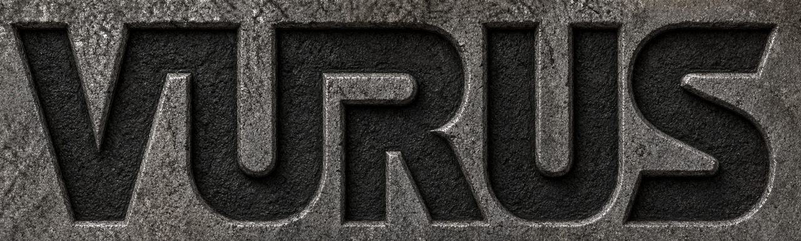
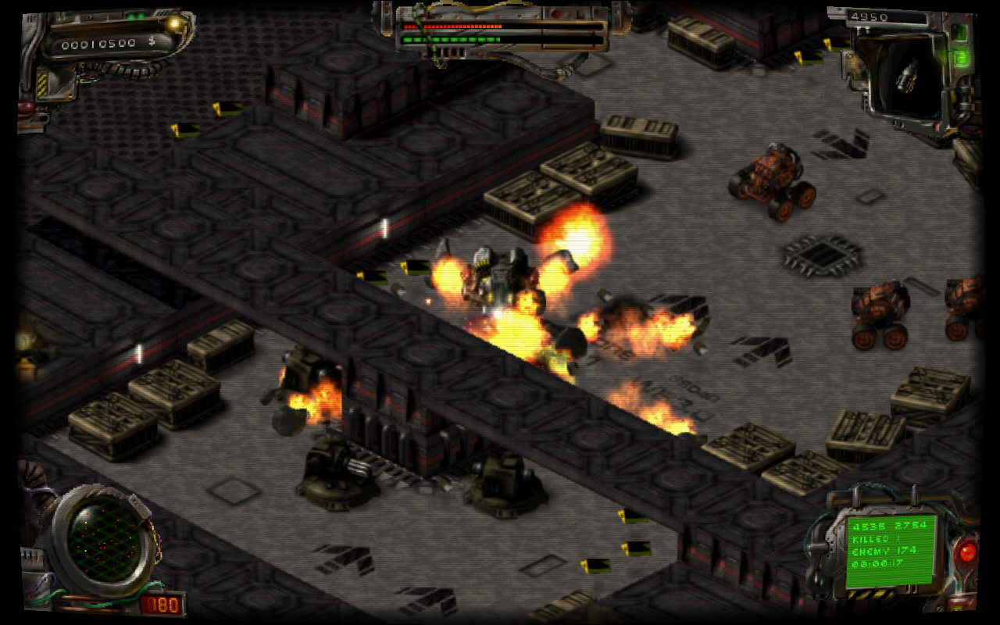
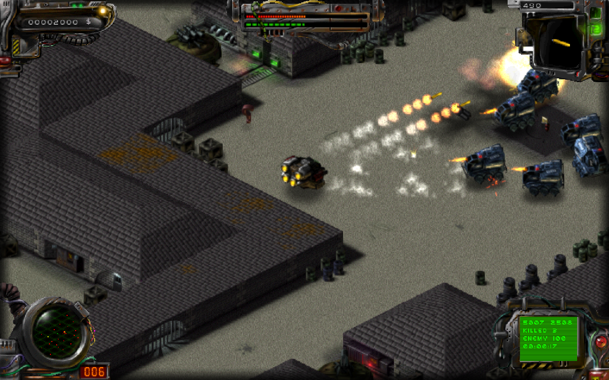
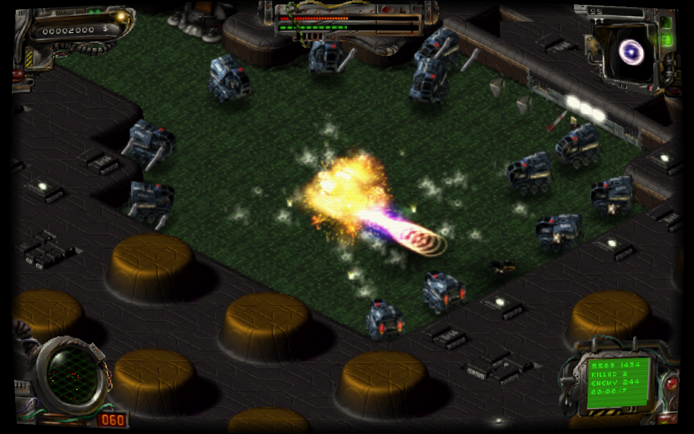

<p align="center">
  
</p>

# Vurus

**Made with AI:** Vurus was developed with **OpenAI Codex** as an AI coding and
reverse-engineering collaborator, directed and play-tested by **rzrbld**. This
is an experimental community project; reports and contributions are welcome.

**Vurus is an unofficial port of Vyruz: Destruction of the Untel Empire,
the 2000 game by C2V.** It is a native reimplementation based on direct reverse
engineering. You must supply your own original game data.

## Get started

Download the package for your platform from GitHub Releases when available.
Development builds are available as artifacts under **Actions → Desktop builds**.
Extract into a writable folder; settings, imported data and saves live beside
the executable.

- **Linux / Steam Deck:** put your original ISO or single-BIN CUE/BIN beside
  `vurus` and `launch.sh`, then run `./launch.sh`.
- **Windows:** run `vurus.exe --data "path\to\game.iso"` in a terminal.
- **macOS:** run `./vurus --data /path/to/game.iso` in a terminal. Builds are
  unsigned and not notarized; macOS security prompts may require user approval.

First startup shows extraction and CD-music import progress. Existing archives
and extracted resource directories also work with `--data`. No original game
files are downloaded or included. See [the player guide](packaging/README.txt)
for controls, storage and command-line options. Native Windows/macOS CI must pass
before those packages are considered validated; hardware testing remains needed.

## Screenshots

Captured from Vurus at **1280×800**, with **FXAA** and **Trilinear sprite
filtering** enabled. Brightness is **50** and vignette is **On**; separate Bloom,
Sharpening and SMAA options are **Off** in all three captures. These are staged
battle captures with player damage disabled.

### HITEK/T2H2 — Retro



**Screen shader: Retro** — CRT effect with warm color correction.

### CAVE/T2C2 — Default



**Screen shader: Off** — FXAA and Trilinear remain enabled; “Default” here refers
only to the screen shader.

### CPU/T3P1 — Bright



**Screen shader: Bright** — warm CRT effect with its built-in highlight glow;
the separate Bloom option is Off.

## Copyright, trademarks and affiliation

Vyruz: Destruction of the Untel Empire was developed by C2V. All original game
names, logos, trademarks, artwork, characters, music, sound effects and other
original game content belong to their respective copyright and trademark holders.
All rights to that original content are reserved by those holders.

Vurus is an independent, unofficial project. It is not affiliated with, endorsed
by or sponsored by C2V or the original game's rights holders. References to the
original game and the screenshots shown here identify and illustrate the game
being reimplemented; this project claims no ownership of the original content.
Any license applying to Vurus's code does not grant rights to original game
assets or third-party names and logos.

## Controls and options

Keyboard/mouse and SDL2 controllers are supported. In menus, use arrows/Enter,
left stick or D-pad/A, or mouse; B/Escape goes back. Right stick aims and the right
trigger fires. Controls are remappable. Optional controller aim assistance has
Off, Slight, Medium and Full modes; it targets enemies, never destructible scenery.

Video → Advanced includes window/fullscreen/borderless modes, independent HUD
aspect, sprite filtering, vignette and Off/CRT/Retro/Bright screen shaders.
FXAA and SMAA are mutually exclusive, with optional bloom and sharpening.
SMAA is unavailable on macOS's legacy OpenGL path. Audio has separate effects,
voices, music and menu sounds. `--debug` enables the testing menu, FPS/frame-time
counter and F2 shortcut; ordinary launches hide them.

## Build

Requires a C++20 compiler, CMake, Rust/Cargo (CI pins 1.99.0), SDL2 and OpenGL development files.
The Indeo decoder builds offline from the vendored source, without Cargo packages.

```sh
cmake -S . -B build -DCMAKE_BUILD_TYPE=Release -DBUILD_TESTING=ON
cmake --build build --config Release --parallel 2
ctest --test-dir build -C Release --output-on-failure --parallel 2
./build/vurus --data /path/to/game.iso
```

On Linux, install `g++ cmake libsdl2-dev libgl1-mesa-dev` and Rust. Package with
`sh packaging/package_linux.sh build dist`. On Windows use Visual Studio 2022
and a Windows SDK; macOS needs Xcode command-line tools. Windows/macOS builds
use SDL2 source via `-DVYRUZ_SDL_SOURCE=/absolute/path/to/SDL`, then
`cmake --build build --config Release --target package` creates a portable ZIP.
The included Actions workflow builds Linux x64, Windows x64, macOS arm64 and
macOS x64. macOS targets version 15 or later. OS libraries and graphics drivers
remain dependencies; this is not a completely static OS-independent executable.

## Credits and licenses

- **C2V:** original Vyruz game. Its names, artwork and other content remain with
  their respective rights holders; none is licensed by the engine's MIT license.
- **rzrbld:** project direction, testing and release maintenance.
- **OpenAI Codex:** AI development collaborator for implementation, reverse
  engineering, testing and documentation; not a GitHub account or an endorsement
  by OpenAI.
- [SDL2](https://github.com/libsdl-org/SDL): windows, input and audio; zlib license.
- [OxideAV/oxideav-indeo](https://github.com/OxideAV/oxideav-indeo): Indeo5 video
  decoder, MIT, Karpelès Lab Inc. and contributors. [Vendoring notes](third_party/oxideav-indeo/VENDORED.md).
- [TheCodeTherapy/MAME-PSGS](https://github.com/TheCodeTherapy/MAME-PSGS): original
  CRT shader by Marco Gomez, Apache-2.0. Vurus adapts its geometry and effects;
  [provenance and modifications](third_party/mame-psgs/VENDORED.md).
- [iryoku/SMAA](https://github.com/iryoku/smaa): anti-aliasing by Jorge Jimenez,
  Jose I. Echevarria, Belen Masia, Fernando Navarro and Diego Gutierrez; MIT.
  [Vendoring notes](third_party/smaa/VENDORED.md).
- [Rust](https://github.com/rust-lang/rust): the video bridge and statically linked
  standard library; Apache-2.0/MIT plus retained component notices.
- [OpenGL](https://www.opengl.org/) and platform graphics drivers provide rendering.
  [CMake](https://github.com/Kitware/CMake) and platform C++ compilers provide the build toolchain.

The engine is MIT-licensed. See [LICENSE.md](LICENSE.md) for the engine license,
third-party texts and links to additional notices. `vurus --licenses` prints the
embedded decoder, Rust and shader notices. Third-party copyright and license
notices remain in `third_party/` and are included with binary packages.

## Contributing

Please include the map, reproduction steps, OS and graphics settings in bug
reports. Do not upload original game archives, disc images, extracted assets,
saves, credentials or private development material. Synthetic tests require no
original game data. Game screenshots above are the selected documentation images;
playable original resources are not part of this repository or its packages.
