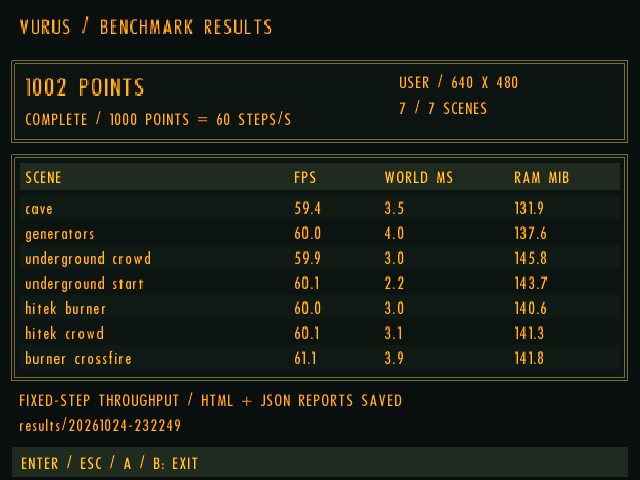
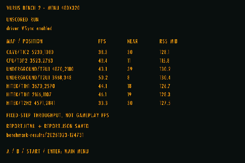

<p align="center">
  
</p>

# Vurus

**Made with AI:** Vurus was developed with **OpenAI Codex** as an AI coding and
reverse-engineering collaborator, directed and play-tested by **rzrbld**. This
is an experimental community project; reports and contributions are welcome.

**Vurus is an unofficial port of Vyruz: Destruction of the Untel Empire,
the 2000 game by C2V.** It is a native reimplementation based on direct reverse
engineering. You must supply your own original game data.

## How to run

Download your platform's package from **[GitHub Releases](https://github.com/rzrbld/vurus/releases)**
and verify it with the accompanying `SHA256SUMS.txt`. Desktop and PortMaster
packages are listed separately. CI artifacts are optional testing builds.
You need your own original game disc image or extracted resources.

### Desktop and Steam Deck

Extract the package into a writable folder.

- **Linux / Steam Deck:** place your original ISO or single-BIN CUE/BIN beside
  `vurus` and `launch.sh`, then run `./launch.sh`. On Steam Deck, start from
  Desktop Mode; the launcher can also be added as a non-Steam game.
- **Windows:** place the original disc image beside `vurus.exe` and run it.
  You can also select resources with `vurus.exe --data "path\to\game.iso"`.
- **macOS:** run `./vurus --data /path/to/game.iso` in a terminal. Builds require
  macOS 15 or later and are unsigned/not notarized.

### Handhelds with PortMaster

Requires an **ARM64 device with OpenGL ES 3.0 or later**, running muOS or another
PortMaster-compatible firmware.

1. Install PortMaster on your device.
2. Extract `Vurus.sh` and the `vurus/` folder together into the firmware's
   `ports` directory.
3. Place your original ISO or single-BIN CUE/BIN inside `vurus/`, beside
   `vurus.aarch64`. Alternatively, copy an existing imported `data/` folder there.
4. Start **Vurus** from the firmware's Ports menu. The first launch imports the
   resources and CD music, with progress and controller navigation.

Keep your existing `data/`, saves and settings when upgrading. See the
[handheld installation guide](packaging/portmaster/README.txt) for details.
Desktop first launch also shows import progress. No original game files are
included or downloaded. The [player guide](packaging/README.txt) covers controls,
settings and command-line options.

## Port Features

- **Native Linux, Windows and macOS builds**, with Steam Deck and ARM64
  PortMaster handheld support.
- **OpenGL rendering** on desktop and **OpenGL ES** on handhelds.
- **Widescreen and ultrawide support**, multiple resolutions, adaptive HUD,
  windowed/fullscreen/borderless modes.
- **Optional CRT, Retro and Bright shaders**, sprite filtering, FXAA/SMAA,
  bloom and sharpening. Desktop post-processing is unavailable in the GLES build;
  SMAA is unavailable on macOS.
- **Keyboard, mouse and controller support**, remappable controls and
  controller aim assistance for Steam Deck and handheld play.

## Performance

**H700:** Anbernic RG40XX H, muOS, 640×480, trilinear filtering,
VSync off; **1002 points**. Run: 2026-10-24T23:22:49Z.
**RK3326:** ArkOS, 480×320, nearest filtering; 2026-10-23.
Driver VSync remains enabled, so the RK3326 run is unscored.

| Map / start position | Enemies nearby¹ | H700 bench FPS | H700 RSS MiB² | RK3326 bench FPS | RK3326 RSS MiB² |
| --- | ---: | ---: | ---: | ---: | ---: |
| CAVE/T1C2 · 5230,1080 | 30 | 59.4 | 131.9 | 38.3 | 128.1 |
| CPU/T3P2 · 3523,2763 | 11 | 60.0 | 137.6 | 49.4 | 115.8 |
| UNDERGROUND/T2U1 · 4870,2180 | 39 | 59.9 | 145.8 | 43.1 | 130.2 |
| UNDERGROUND/T2U1 · 3968,348 | 8 | 60.1 | 143.7 | 50.2 | 130.4 |
| HITEK/T1H1 · 3670,2570 | 18 | 60.0 | 140.6 | 44.1 | 126.7 |
| HITEK/T1H1 · 2166,1107 | 19 | 60.1 | 141.3 | 46.1 | 128.3 |
| HITEK/T2H2 · 4571,2841 | 30 | 61.1 | 141.8 | 33.3 | 127.5 |

Seven scenes, 120 warmup + 1,200 measured steps each; ground details, shadows,
reactor FX and vignette on, music off. Bench FPS measures one fixed simulation
tick and rendered frame per step. Different settings and combat populations
mean these are separate runs, not a controlled hardware comparison.
¹ Alive enemies within 1,000 world units at spawn. ² Highest sampled process RSS.
Raw results: [H700](docs/benchmarks/h700-2026-10-25-beta2.json) ·
[RK3326](docs/benchmarks/rk3326-2026-10-23-user.json).

 

*Results screens: H700 left, RK3326 right.*

## Screenshots

Captured from Vurus at **1280×800**, with **FXAA** and **Trilinear sprite
filtering** enabled. Brightness is **50** and vignette is **On**; separate Bloom,
Sharpening and SMAA options are **Off** in all three captures. These are staged
battle captures with player damage disabled.

### HITEK/T2H2 — Retro


**Screen shader: Retro** — CRT effect with warm color correction.

### CAVE/T2C2 — No Shader


**Screen shader: Off** — FXAA and Trilinear filtering remain enabled.

### CPU/T3P1 — Bright


**Screen shader: Bright** — warm CRT effect with its built-in highlight glow;
the separate Bloom option is Off.

## Copyright, trademarks and affiliation

Vyruz: Destruction of the Untel Empire was developed by C2V. All original game
names, logos, trademarks, artwork, characters, music, sound effects and other
original game content belong to their respective copyright and trademark holders.
All rights to that original content are reserved by those holders.

Vurus is an independent, unofficial project. It is not affiliated with, endorsed
by or sponsored by C2V or the original game's rights holders. References to the
original game and the screenshots shown here identify and illustrate the game
being reimplemented; this project claims no ownership of the original content.
Any license applying to Vurus's code does not grant rights to original game
assets or third-party names and logos.

## Quick start build

### Desktop

Requires a C++20 compiler, CMake, Rust/Cargo, SDL2, OpenGL and zlib development
files. From the source directory:

```sh
cmake -S . -B build -DCMAKE_BUILD_TYPE=Release -DBUILD_TESTING=ON -DVURUS_BUILD_BENCHMARK=ON
cmake --build build --config Release --parallel 2
ctest --test-dir build -C Release --output-on-failure --parallel 2
```

After importing your game data, run `./build/vurus-bench --data /path/to/existing/resources`
to check performance across seven scenes and produce a score plus HTML/JSON reports.
It uses your in-game video settings with VSync off and FPS uncapped; add
`--default-settings` for the fixed preset. See the [benchmark manual](docs/benchmark.md)
for Windows/PortMaster commands, report locations and comparisons.

Windows/macOS builds need additional SDL2/zlib source configuration; see the
[full build guide](docs/building.md#desktop-builds).

### Handheld / PortMaster

Use an ARM64 Docker host, or Docker configured for ARM64 emulation:

```sh
docker build --platform linux/arm64 -t vurus-portmaster-builder:local packaging/portmaster
mkdir -p work/portmaster-build dist/portmaster
docker run --rm --platform linux/arm64 \
  -v "$PWD:/source:ro" \
  -v "$PWD/work/portmaster-build:/build" \
  -v "$PWD/dist/portmaster:/dist" \
  vurus-portmaster-builder:local sh /source/tools/build_portmaster.sh /build /dist
```

The package is `dist/portmaster/vurus-portmaster.zip`.
The [full build guide](docs/building.md) covers dependencies, platform flags,
packaging and the separate desktop/handheld CI workflows.

## Credits and licenses

- **C2V:** original Vyruz game. Its names, artwork and other content remain with
  their respective rights holders; none is licensed by the engine's MIT license.
- **rzrbld:** project direction, testing and release maintenance.
- **OpenAI Codex:** AI development collaborator for implementation, reverse
  engineering, testing and documentation; not a GitHub account or an endorsement
  by OpenAI.
- [zlib](https://zlib.net/): save compression, by Jean-loup Gailly and Mark Adler;
  zlib license.
- [SDL2](https://github.com/libsdl-org/SDL): windows, input and audio; zlib license.
- [OxideAV/oxideav-indeo](https://github.com/OxideAV/oxideav-indeo): Indeo5 video
  decoder, MIT, Karpelès Lab Inc. and contributors. [Vendoring notes](third_party/oxideav-indeo/VENDORED.md).
- [TheCodeTherapy/MAME-PSGS](https://github.com/TheCodeTherapy/MAME-PSGS): original
  CRT shader by Marco Gomez, Apache-2.0. Vurus adapts its geometry and effects;
  [provenance and modifications](third_party/mame-psgs/VENDORED.md).
- [iryoku/SMAA](https://github.com/iryoku/smaa): anti-aliasing by Jorge Jimenez,
  Jose I. Echevarria, Belen Masia, Fernando Navarro and Diego Gutierrez; MIT.
  [Vendoring notes](third_party/smaa/VENDORED.md).
- [Rust](https://github.com/rust-lang/rust): the video bridge and statically linked
  standard library; Apache-2.0/MIT plus retained component notices.
- [OpenGL](https://www.opengl.org/) and platform graphics drivers provide rendering.
  [CMake](https://github.com/Kitware/CMake) and platform C++ compilers provide the build toolchain.

The engine is MIT-licensed. See [LICENSE.md](LICENSE.md) for the engine license,
third-party texts and links to additional notices. `vurus --licenses` prints the
embedded decoder, Rust and shader notices. Third-party copyright and license
notices remain in `third_party/` and are included with binary packages.

## Contributing


Please include the map, reproduction steps, OS and graphics settings in bug
reports. Do not upload original game archives, disc images, extracted assets,
saves, credentials or private development material. Synthetic tests require no
original game data. Game screenshots above are the selected documentation images;
playable original resources are not part of this repository or its packages.
