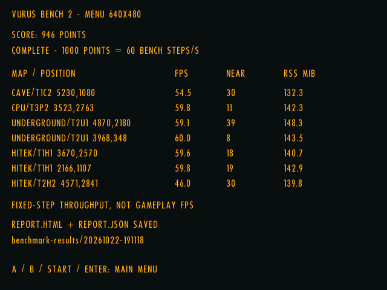

# H700 performance update — 2026-10-22

These are retained results from the seven-scene on-device benchmark used to
validate the new Extras menu. No new profiling run was made for this report.
The README uses the latest **User Settings** run throughout: trilinear filtering
and ground details enabled, **946 points**. A separate **Default** run scored
**959 points**. These are individual functional-validation runs, not repeated
A/B experiments or a quantified speedup against the October 21 report.

## Build, device and method

- Anbernic RG40XX H, Allwinner H700, Mali-G31, 1 GB RAM, muOS; real ALSA audio.
- OpenGL ES 3.2, ARM proprietary driver `v1.r20p0-01rel0.8ec337de4ddab3365a32cff58063a9da`.
- Local build `dev-benchmark-menu-20261022`, based on public
  [`e43afbd`](https://github.com/rzrbld/vurus/commit/e43afbde8fa58fd4b47bb47989871aaf0124736a)
  plus the pending shared benchmark/menu integration. These are development-build
  results, not measurements of an existing downloadable release.
- Protocol `vurus-bench-2`, JSON schema 3, Normal difficulty, 120 warmup and
  1,200 measured steps per scene. One fixed 1/60-second simulation tick and one
  complete rendered/presented frame per step; seven scenes, 8,400 measured steps.
- 640×480 windowed; requested VSync off, actual swap interval 0, FPS cap 0.
  Shadows, reactor FX and vignette on; music off. FX/voices use fixed benchmark
  audio settings, 48 kHz/32-bit/stereo and 70% master volume.
- The game releases its World, renderer and audio device before the benchmark.
  Each scene starts in a fresh session. Isolated settings and report folders;
  installed engines, saves, settings and leaderboard remained unchanged.
- Private SDL event injection selected menu entries and confirmed results after
  three seconds. Input polling/injection is outside measured steps. The user
  also observed the working flow. Source/build and UI checks accompanied the runs;
  these scores are not an optimization A/B measurement.

| Preset | Started UTC | Filtering | Ground details | Score |
| --- | --- | --- | --- | ---: |
| Default | 2026-10-22T19:08:10Z | Nearest | Off | 959 |
| User Settings | 2026-10-22T19:11:18Z | Trilinear | On | 946 |

Unsupported desktop post-effects are disabled on GLES. Neither run enables CRT,
FXAA/SMAA, bloom or sharpen. Compare scores only at matching effective settings
and output size. Score = round(1,000 × geometric mean of per-scene mean step
throughput / 60); each scene has equal weight. Both scores were independently
recomputed from the JSON means, with crossfire overlap validated.

## Encounter throughput and memory

Nearby means alive enemies within 1,000 world units of the initial player position;
it is not a visible or awake count. CPU/T3P2 moves between generator stations;
its listed coordinates are the initial position. Other scripts use no movement input,
change facing every 120 steps and weapons/ammo every 600 steps, with invulnerability
and held fire. The final Burner encounter has a stationary, non-firing player,
benchmark-only enemy indestructibility and ordinary Burner AI/fire cadence.
These are real rendered port workloads with test controls, not original Windows
playthroughs or whole-map averages. See the [benchmark manual](benchmark.md).

| Map / start | Nearby enemies | Default FPS | User FPS | User startup RSS MiB | User sampled peak RSS MiB |
| --- | ---: | ---: | ---: | ---: | ---: |
| CAVE/T1C2 · 5230,1080 | 30 | 57.77 | 54.47 | 115.45 | 132.33 |
| CPU/T3P2 · 3523,2763 | 11 | 59.97 | 59.82 | 125.66 | 142.30 |
| UNDERGROUND/T2U1 · 4870,2180 | 39 | 59.29 | 59.09 | 133.28 | 148.30 |
| UNDERGROUND/T2U1 · 3968,348 | 8 | 60.04 | 60.01 | 129.11 | 143.45 |
| HITEK/T1H1 · 3670,2570 | 18 | 59.82 | 59.61 | 130.70 | 140.70 |
| HITEK/T1H1 · 2166,1107 | 19 | 59.82 | 59.75 | 130.04 | 142.95 |
| HITEK/T2H2 · 4571,2841 | 30 | 47.43 | 45.97 | 134.89 | 139.80 |

FPS is 1,000 divided by mean measured step milliseconds, not the median's inverse
or the mean of instantaneous FPS. RSS is process resident memory, sampled at scene
start, periodically every 120 steps (including warmup), and at the end. The sampled
maximum can miss short peaks and excludes total system/GPU memory; startup and
sampled peaks must not be substituted for each other. Presets ran in separate
processes, so neither RSS nor FPS differences establish isolated effects costs.

## Latest User Settings run: timing distributions

Milliseconds, directly from each scene's 1,200 measured samples. CPU stages are
per tick; render/present and complete step are per frame. CPU update includes World,
animation, audio and other update work. Stages are nested and medians/percentiles
are independent; do not add their quantiles to reconstruct the frame. Render/present
includes CPU scene preparation, driver submission and swap, not isolated GPU time.

| Map / start | Stage | Median | p95 | p99 | Maximum |
| --- | --- | ---: | ---: | ---: | ---: |
| CAVE/T1C2 · 5230,1080 | World | 3.607 | 5.726 | 7.051 | 12.214 |
| CAVE/T1C2 · 5230,1080 | Animation | 1.978 | 2.698 | 3.362 | 4.088 |
| CAVE/T1C2 · 5230,1080 | Audio | 0.431 | 0.945 | 1.194 | 1.415 |
| CAVE/T1C2 · 5230,1080 | CPU update total | 6.960 | 10.051 | 12.521 | 18.240 |
| CAVE/T1C2 · 5230,1080 | Render / present | 10.439 | 14.262 | 18.973 | 26.542 |
| CAVE/T1C2 · 5230,1080 | Complete step | 17.518 | 24.151 | 28.545 | 37.343 |
| CPU/T3P2 · 3523,2763 | World | 3.813 | 5.087 | 5.795 | 9.781 |
| CPU/T3P2 · 3523,2763 | Animation | 1.813 | 2.404 | 2.905 | 5.483 |
| CPU/T3P2 · 3523,2763 | Audio | 0.461 | 0.931 | 1.310 | 1.774 |
| CPU/T3P2 · 3523,2763 | CPU update total | 6.852 | 8.864 | 10.061 | 16.771 |
| CPU/T3P2 · 3523,2763 | Render / present | 9.636 | 14.243 | 24.963 | 29.649 |
| CPU/T3P2 · 3523,2763 | Complete step | 16.531 | 20.344 | 30.924 | 35.757 |
| UNDERGROUND/T2U1 · 4870,2180 | World | 3.184 | 4.330 | 5.346 | 13.693 |
| UNDERGROUND/T2U1 · 4870,2180 | Animation | 1.743 | 2.305 | 2.642 | 5.139 |
| UNDERGROUND/T2U1 · 4870,2180 | Audio | 0.380 | 0.945 | 1.463 | 2.087 |
| UNDERGROUND/T2U1 · 4870,2180 | CPU update total | 6.083 | 8.060 | 9.337 | 17.409 |
| UNDERGROUND/T2U1 · 4870,2180 | Render / present | 10.249 | 13.088 | 14.738 | 26.182 |
| UNDERGROUND/T2U1 · 4870,2180 | Complete step | 16.567 | 19.931 | 22.960 | 31.570 |
| UNDERGROUND/T2U1 · 3968,348 | World | 2.081 | 3.119 | 4.672 | 6.351 |
| UNDERGROUND/T2U1 · 3968,348 | Animation | 1.620 | 2.053 | 2.324 | 3.167 |
| UNDERGROUND/T2U1 · 3968,348 | Audio | 0.336 | 0.542 | 0.784 | 1.074 |
| UNDERGROUND/T2U1 · 3968,348 | CPU update total | 4.750 | 6.344 | 7.878 | 10.675 |
| UNDERGROUND/T2U1 · 3968,348 | Render / present | 11.219 | 16.984 | 21.835 | 29.202 |
| UNDERGROUND/T2U1 · 3968,348 | Complete step | 16.536 | 21.275 | 26.511 | 33.414 |
| HITEK/T1H1 · 3670,2570 | World | 3.161 | 4.879 | 6.115 | 6.821 |
| HITEK/T1H1 · 3670,2570 | Animation | 1.729 | 2.173 | 2.565 | 3.600 |
| HITEK/T1H1 · 3670,2570 | Audio | 0.340 | 0.544 | 0.698 | 1.155 |
| HITEK/T1H1 · 3670,2570 | CPU update total | 6.003 | 8.055 | 9.444 | 10.617 |
| HITEK/T1H1 · 3670,2570 | Render / present | 10.042 | 14.178 | 15.552 | 27.691 |
| HITEK/T1H1 · 3670,2570 | Complete step | 16.627 | 19.612 | 22.625 | 33.005 |
| HITEK/T1H1 · 2166,1107 | World | 2.847 | 4.035 | 4.769 | 6.255 |
| HITEK/T1H1 · 2166,1107 | Animation | 1.838 | 2.329 | 2.679 | 3.717 |
| HITEK/T1H1 · 2166,1107 | Audio | 0.366 | 0.844 | 1.098 | 1.373 |
| HITEK/T1H1 · 2166,1107 | CPU update total | 5.866 | 7.571 | 9.113 | 10.840 |
| HITEK/T1H1 · 2166,1107 | Render / present | 10.009 | 14.590 | 20.982 | 26.127 |
| HITEK/T1H1 · 2166,1107 | Complete step | 16.477 | 19.882 | 26.354 | 31.572 |
| HITEK/T2H2 · 4571,2841 | World | 5.146 | 6.850 | 7.831 | 10.184 |
| HITEK/T2H2 · 4571,2841 | Animation | 2.462 | 3.055 | 3.490 | 3.930 |
| HITEK/T2H2 · 4571,2841 | Audio | 0.654 | 1.162 | 1.440 | 1.781 |
| HITEK/T2H2 · 4571,2841 | CPU update total | 9.497 | 11.405 | 12.609 | 15.140 |
| HITEK/T2H2 · 4571,2841 | Render / present | 12.057 | 13.522 | 14.554 | 17.241 |
| HITEK/T2H2 · 4571,2841 | Complete step | 21.616 | 23.971 | 26.044 | 28.774 |

The prior report used different scripts/scheduling and settings; its old live-App
numbers and this fixed-step benchmark are not a controlled before/after pair.
These runs also do not establish hitch-free play or a GPU bottleneck. Neither
preset changes gameplay or removes original shadows, vignette or FX.

## Captured results and raw data

Unmodified retained Mali result-screen capture from the User Settings run. The
54.5 figure for CAVE/T1C2 is its run mean throughput; it is not a selected
instantaneous overlay reading. This replaces the older 40.1-FPS gameplay frame in
the README. A new gameplay screenshot was not captured for this documentation edit.

- [User Settings JSON](benchmarks/h700-2026-10-22-user.json): all effective options,
  device fields, source-map fingerprints, populations, crossfire counters and
  complete timing distributions used by the README.
- [Default JSON](benchmarks/h700-2026-10-22-default.json): fixed-preset run with the
  same seven-scene protocol.
- [Previous performance report](performance_update_2026-10-21.md): earlier live-App
  and fixed-step controls; retained as historical evidence.
