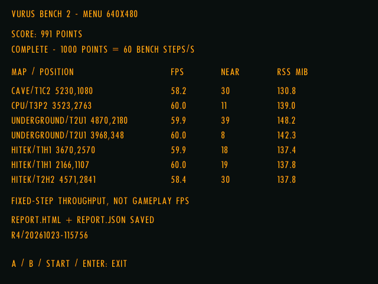

# H700 performance update — 2026-10-23

The renderer now prepares bodies from the original padded camera-cell window,
using Y/X/cell-list order with in-ground bodies first, instead of preparing bodies
across the whole map before screen rejection. This is shared by desktop OpenGL
and handheld GLES; the measurements below are on the H700 only.

The final screenshot run reaches **58.37 bench FPS in Burner**, versus **47.86**
in the latest matched baseline (**+21.98%**). Its mean render/present interval
falls from **11.40 to 7.50 ms**. These are fixture-specific results, not a universal
22% gain or isolated GPU timings. The README and screenshot both use run R4.

## Source, device and protocol

- Source: [265650c](https://github.com/rzrbld/vurus/commit/265650ca16690c43f6dc45679073f3d218053e7a). The ARM development label in raw results is
  `native-cell-render-final-20261023`; its renderer source matches this commit.
  These are development-build measurements, not a newly published binary release.
- Anbernic RG40XX H, H700 (`sun50iw9`), Mali-G31, 1 GB RAM, muOS; GLES 3.2,
  proprietary driver `v1.r20p0-01rel0.8ec337de4ddab3365a32cff58063a9da`, ALSA.
- Protocol `vurus-bench-2`, schema 3, Normal difficulty; seven scenes, each with
  120 warmup and 1,200 measured steps. Every step runs one fixed 1/60-second tick
  and one complete rendered/presented frame. No concurrent builds or tests.
- Copied game-menu settings: 640×480, trilinear filtering, ground details, shadows,
  reactor FX and vignette on; music off, cap 0, requested VSync off and actual
  swap interval 0. Desktop post-effects disabled. This is the **User Settings** preset.
- Each scene starts fresh. Other scenes hold player fire; Burner uses a stationary,
  non-firing invulnerable player and benchmark-only enemy indestructibility with
  ordinary Burner AI/fire cadence. See the [benchmark manual](benchmark.md).
- Isolated test folders and copied settings; 81 normal-install file hashes remained
  unchanged through each final test, including R4. The installed game and standalone
  benchmark were updated separately before R4, with the prior engines backed up.
  Saves, menu settings, leaderboard and imported resources were preserved.

FPS = 1,000 / mean complete-step milliseconds. This fixed-step throughput is not
ordinary gameplay FPS. Score = round(1,000 × geometric mean of per-scene throughput
/ 60), giving equal weight to each scene. R4 scores **991**. Nearby enemies means
alive enemies within 1,000 world units at spawn, not visible or awake enemies.
RSS is process resident memory sampled periodically; it can miss short peaks and
is not total system/GPU memory.

## Controlled repeats

The initial baseline/candidate pair B2/R1 was repeated in reverse order R2/B3.
R1/R2 precede the final newborn-explosion bookkeeping guard. R3/R4 measure the
final guarded implementation. All seven scenes match in initial/final actor rows,
final live population, peak projectiles, map fingerprints and firing-overlap counters.
In Burner every run retains **1,445 rows / 1,389 live / 19 peak projectiles** and
**1,155 of 1,200 steps with at least two Burners firing within the last 100 ms**.
This protects against mistaking reduced combat activity for a speedup.

| Run | Implementation | Score | Burner FPS | Mean World ms | Mean render/present ms | Sampled RSS MiB |
| --- | --- | ---: | ---: | ---: | ---: | ---: |
| [B2](benchmarks/h700-2026-10-23-native-cells-b2.json) | Baseline | 950 | 47.70 | 5.156 | 11.503 | 133.29 |
| [R1](benchmarks/h700-2026-10-23-native-cells-r1.json) | Camera cells, pre-guard | 993 | 58.33 | 5.286 | 7.567 | 137.70 |
| [R2](benchmarks/h700-2026-10-23-native-cells-r2.json) | Camera cells, pre-guard | 993 | 58.76 | 5.246 | 7.516 | 139.25 |
| [B3](benchmarks/h700-2026-10-23-native-cells-b3.json) | Baseline | 952 | 47.86 | 5.176 | 11.400 | 137.69 |
| [R3](benchmarks/h700-2026-10-23-native-cells-r3.json) | Camera cells, final | 992 | 58.19 | 5.257 | 7.578 | 137.12 |
| [R4](benchmarks/h700-2026-10-23-native-cells-r4.json) | Camera cells, final | 991 | 58.37 | 5.241 | 7.503 | 137.82 |

The reverse-order pairs average 47.78 → 58.54 FPS (+22.53%) before the final guard;
the final two confirmations reach 58.19 and 58.37. Lighter scenes sit close to
60 steps/s, so their small differences are not evidence of another measured gain.
Timing tails and memory vary between processes; no hitch-free or memory-saving
claim is made. Governor/clock endpoint readings do not prove identical clocks
throughout every run. This is not a comparison with the older October 22 build.

## Latest results — R4

| Map / start position | Bench FPS | Enemies nearby¹ | RSS MiB² |
| --- | ---: | ---: | ---: |
| CAVE/T1C2 · 5230,1080 | 58.2 | 30 | 130.8 |
| CPU/T3P2 · 3523,2763 | 60.0 | 11 | 139.0 |
| UNDERGROUND/T2U1 · 4870,2180 | 59.9 | 39 | 148.2 |
| UNDERGROUND/T2U1 · 3968,348 | 60.0 | 8 | 142.3 |
| HITEK/T1H1 · 3670,2570 | 59.9 | 18 | 137.4 |
| HITEK/T1H1 · 2166,1107 | 60.0 | 19 | 137.8 |
| HITEK/T2H2 · 4571,2841 | 58.4 | 30 | 137.8 |

## Latest timing distributions — R4

Milliseconds from 1,200 measured samples per scene. World, animation, audio and
CPU total are per tick; render/present and full step are per frame. CPU total
includes the earlier CPU stages. Quantiles are independent and should not be
added. Render/present includes CPU scene composition, driver submission and swap;
it does not establish GPU saturation.

| Map / start | Stage | Mean | Median | p95 | p99 | Maximum |
| --- | --- | ---: | ---: | ---: | ---: | ---: |
| CAVE/T1C2 · 5230,1080 | World | 3.979 | 3.785 | 5.874 | 7.439 | 10.639 |
| CAVE/T1C2 · 5230,1080 | Animation | 2.169 | 2.073 | 2.864 | 3.420 | 5.043 |
| CAVE/T1C2 · 5230,1080 | Audio | 0.493 | 0.420 | 1.028 | 1.366 | 2.023 |
| CAVE/T1C2 · 5230,1080 | CPU update total | 7.604 | 7.328 | 10.374 | 12.417 | 17.966 |
| CAVE/T1C2 · 5230,1080 | Render / present | 9.590 | 8.933 | 14.943 | 20.645 | 30.678 |
| CAVE/T1C2 · 5230,1080 | Complete step | 17.194 | 16.665 | 22.298 | 27.588 | 37.229 |
| CPU/T3P2 · 3523,2763 | World | 3.970 | 3.958 | 5.354 | 6.508 | 8.600 |
| CPU/T3P2 · 3523,2763 | Animation | 1.990 | 1.910 | 2.517 | 3.021 | 5.391 |
| CPU/T3P2 · 3523,2763 | Audio | 0.545 | 0.476 | 1.010 | 1.528 | 4.041 |
| CPU/T3P2 · 3523,2763 | CPU update total | 7.218 | 7.138 | 9.376 | 10.944 | 17.610 |
| CPU/T3P2 · 3523,2763 | Render / present | 9.452 | 9.362 | 14.507 | 25.286 | 29.738 |
| CPU/T3P2 · 3523,2763 | Complete step | 16.670 | 16.574 | 21.477 | 32.484 | 36.683 |
| UNDERGROUND/T2U1 · 4870,2180 | World | 3.354 | 3.264 | 4.596 | 5.399 | 10.078 |
| UNDERGROUND/T2U1 · 4870,2180 | Animation | 1.937 | 1.847 | 2.494 | 2.966 | 4.764 |
| UNDERGROUND/T2U1 · 4870,2180 | Audio | 0.446 | 0.383 | 0.886 | 1.398 | 2.032 |
| UNDERGROUND/T2U1 · 4870,2180 | CPU update total | 6.527 | 6.354 | 8.535 | 9.846 | 14.125 |
| UNDERGROUND/T2U1 · 4870,2180 | Render / present | 10.161 | 9.576 | 16.182 | 23.850 | 25.727 |
| UNDERGROUND/T2U1 · 4870,2180 | Complete step | 16.688 | 16.513 | 21.950 | 30.140 | 33.275 |
| UNDERGROUND/T2U1 · 3968,348 | World | 2.371 | 2.227 | 3.261 | 5.125 | 7.093 |
| UNDERGROUND/T2U1 · 3968,348 | Animation | 1.874 | 1.800 | 2.375 | 2.721 | 4.169 |
| UNDERGROUND/T2U1 · 3968,348 | Audio | 0.387 | 0.354 | 0.586 | 0.851 | 1.043 |
| UNDERGROUND/T2U1 · 3968,348 | CPU update total | 5.399 | 5.152 | 6.932 | 8.535 | 10.306 |
| UNDERGROUND/T2U1 · 3968,348 | Render / present | 11.254 | 11.434 | 16.161 | 24.804 | 30.950 |
| UNDERGROUND/T2U1 · 3968,348 | Complete step | 16.653 | 16.588 | 21.468 | 29.546 | 35.892 |
| HITEK/T1H1 · 3670,2570 | World | 3.569 | 3.409 | 5.461 | 6.979 | 9.756 |
| HITEK/T1H1 · 3670,2570 | Animation | 1.932 | 1.867 | 2.451 | 2.667 | 4.055 |
| HITEK/T1H1 · 3670,2570 | Audio | 0.380 | 0.349 | 0.559 | 0.817 | 1.311 |
| HITEK/T1H1 · 3670,2570 | CPU update total | 6.678 | 6.501 | 8.886 | 10.932 | 13.061 |
| HITEK/T1H1 · 3670,2570 | Render / present | 10.014 | 10.151 | 15.676 | 18.969 | 29.273 |
| HITEK/T1H1 · 3670,2570 | Complete step | 16.692 | 16.601 | 21.816 | 26.193 | 35.396 |
| HITEK/T1H1 · 2166,1107 | World | 3.272 | 3.188 | 4.543 | 5.144 | 6.257 |
| HITEK/T1H1 · 2166,1107 | Animation | 2.080 | 2.034 | 2.626 | 2.913 | 3.506 |
| HITEK/T1H1 · 2166,1107 | Audio | 0.443 | 0.389 | 0.860 | 1.293 | 1.972 |
| HITEK/T1H1 · 2166,1107 | CPU update total | 6.659 | 6.551 | 8.422 | 9.320 | 10.703 |
| HITEK/T1H1 · 2166,1107 | Render / present | 9.997 | 9.946 | 15.778 | 24.140 | 30.183 |
| HITEK/T1H1 · 2166,1107 | Complete step | 16.656 | 16.587 | 21.816 | 29.724 | 36.385 |
| HITEK/T2H2 · 4571,2841 | World | 5.241 | 5.137 | 6.993 | 8.489 | 13.589 |
| HITEK/T2H2 · 4571,2841 | Animation | 2.610 | 2.540 | 3.217 | 3.602 | 4.391 |
| HITEK/T2H2 · 4571,2841 | Audio | 0.733 | 0.654 | 1.206 | 1.589 | 1.961 |
| HITEK/T2H2 · 4571,2841 | CPU update total | 9.628 | 9.498 | 11.828 | 13.547 | 18.561 |
| HITEK/T2H2 · 4571,2841 | Render / present | 7.503 | 6.650 | 13.374 | 17.704 | 39.250 |
| HITEK/T2H2 · 4571,2841 | Complete step | 17.131 | 16.339 | 22.917 | 26.142 | 47.404 |

## Behavior and validation boundary

The retained original `433b30` caller establishes the padded cell window and
Y/X/head order. The change reads existing World cells and maintains derived
channel indices; it does not change World/AI, physics, weapon collisions, sprites,
shaders, quality settings or save schema. See [camera-cell draw admission](formats/native_render_cells.md).

The exact publication candidate builds the game and benchmark and passes all
184 default tests. A separate original-resource audit compared 960 paired frames
on four maps, including fractional camera/cell crossings, detail toggles and file
save/reload. Serialized World and renderer state and ordered audio cues match.
A birth/rebind-only draw-time cursor copy preserves offscreen explosion bookkeeping.

Old-port and native-order pixels intentionally differ in 294 audited frames;
inspected captures did not show obvious missing bodies in those views. Pixel
identity, complete original-game parity and a Windows playthrough are not claimed.
The independent bounds/collision-index experiment and parked weapon changes are
not included.

## Captured screen and raw data

Actual Mali backbuffer capture after R4 completed, converted losslessly from PPM
to PNG. It shows the same run used in the README tables, not a selected
instantaneous gameplay reading. Raw JSON links in the repeat table include all
effective settings, timestamps, populations, fingerprints and timing distributions.
The [October 22 report](performance_update_2026-10-22.md) remains historical.
